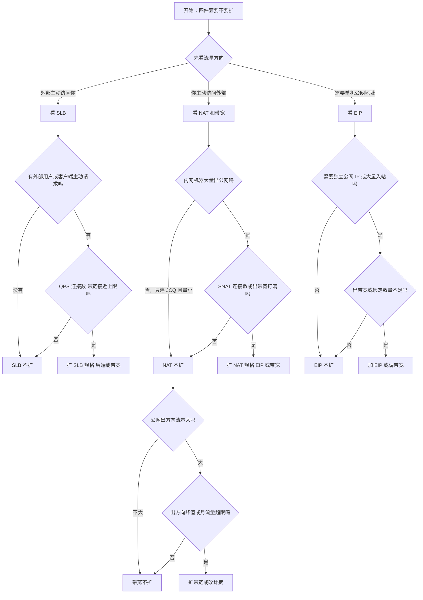
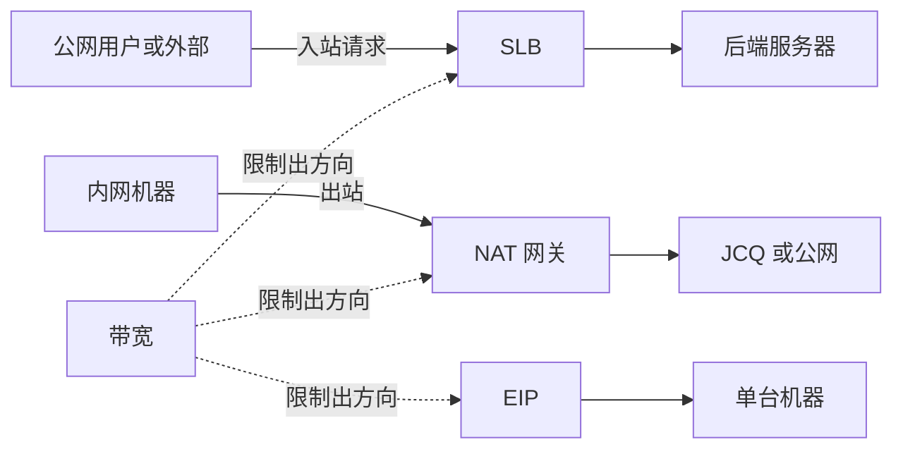

## 详细判断流程图

## 资源关系图

| 资源 | 入方向               | 出方向                 | 和带宽的关系                        |
| :--- | :------------------- | :--------------------- | :---------------------------------- |
| SLB  | 外部请求进来         | SLB 把响应返回给外部   | 响应走出方向，受 SLB/公网出带宽限制 |
| EIP  | 外部访问单机         | 单机响应外部           | 响应走出方向，受 EIP 出带宽限制     |
| NAT  | 外部主动访问内网较少 | 内网机器主动访问公网   | 主动出方向，受 NAT 出带宽限制       |
| 带宽 | 一般不限制或免费     | 限制云上发往公网的数据 | 只管出方向，不管谁先发起            |

**带宽只影响公网出方向。主动访问外部只是出方向的一种；被动响应外部也是出方向**